# App Insights Unlocked

A Google Play Store analytics case study built with Power BI. The report explores app ratings, installs, reviews, categories, genres, content ratings, prices, sizes, and update dates. This repository pairs the supplied case-study brief with dashboard screenshots and an evidence-based solution guide.

> **Reading the answers:** Figures below are transcribed from the supplied dashboard screenshots. When the report does not show the requested metric, the answer says so rather than estimating it from unrelated visuals.

## Project brief

The analysis is intended to help app developers, product managers, marketing teams, and senior management understand user preferences and identify opportunities to improve app quality, discoverability, engagement, and monetization. The dataset is the [Google Play Store Apps dataset on Kaggle](https://www.kaggle.com/datasets/lava18/google-play-store-apps).

The attached brief asks analysts to clean missing and duplicate records, standardize text, convert fields such as installs and price to numeric types, and parse update dates. The supplied Power Query screenshots show duplicate checking and app-size unit conversion. They do not document every cleaning step or establish that all data-quality issues have been resolved.

## Dashboard overview

The overview displays **75.12 billion total installs**, **2.09 billion reviews**, an **average rating of 4.17**, and **8,174 total apps**. It reports **92.66% free apps** and **7.34% paid apps**, and shows category installs, installed genres, and the number of apps by last-update year.

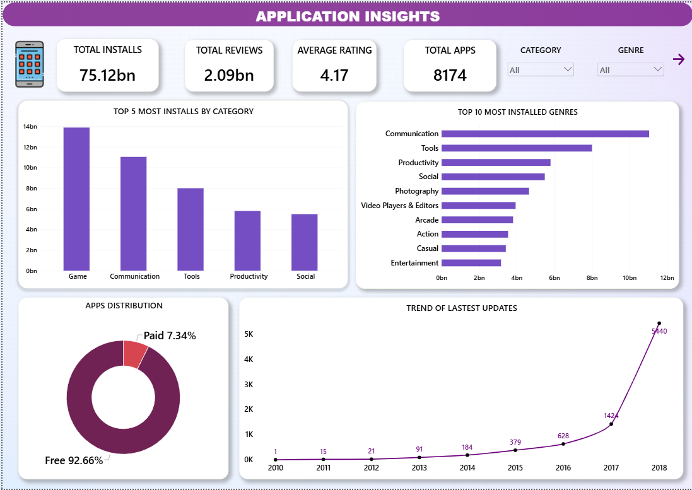

## Basic-level questions

### 1. What is the average rating of apps in the dataset?

**Answer:** The dashboard reports an overall average rating of **4.17 out of 5**. This is the report-wide benchmark for user satisfaction; it does not mean that every app is rated near 4.17.

### 2. How many unique categories of apps are there?

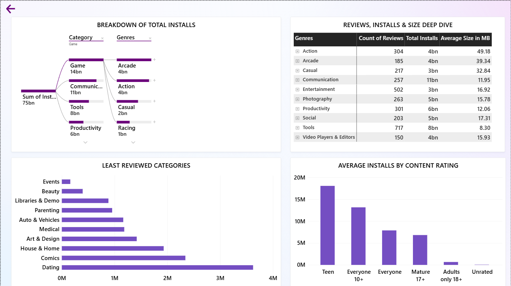

**Answer:** The screenshots do not display a distinct count of categories. The dashboard supports category filtering and shows category-level results, but the exact number of unique categories cannot be read from the supplied visuals. A distinct count of the `Category` field is needed to answer this precisely.

### 3. What is the distribution of app sizes?

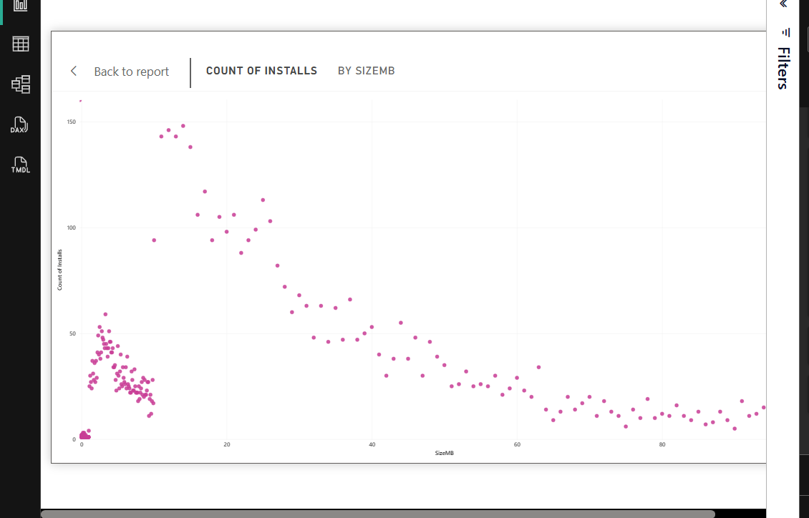

**Answer:** The size visual shows many observations clustered among smaller app sizes, with fewer as size increases. It is a count-by-size view, not a summary of exact size percentiles or an average app size. The screenshots do not provide those distribution statistics.

### 4. How many free vs. paid apps are there?

**Answer:** The dashboard reports **92.66% free** and **7.34% paid**. These are proportions, not raw counts. The overview's **8,174-app** total does not match the **8,190** rows shown in the content-rating screenshot, so raw free/paid counts should be checked against the final model before reporting.

### 5. What is the most common content rating for apps?

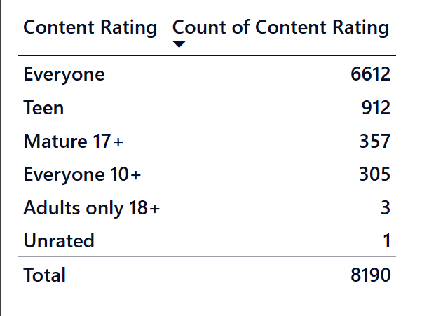

**Answer:** **Everyone** is the most common content rating, with **6,612 apps**. The screenshot then shows Teen (912), Mature 17+ (357), Everyone 10+ (305), Adults only 18+ (3), and Unrated (1), for a displayed total of **8,190**.

### 6. What are the top 5 most installed apps?

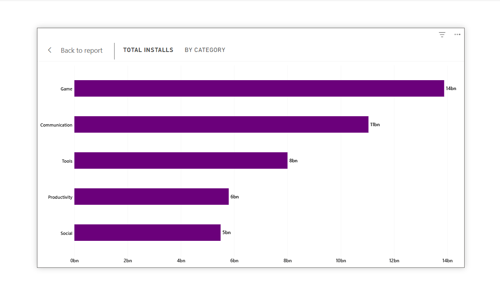

**Answer:** The supplied dashboard shows installs aggregated by category and genre, but it does not show a ranked list of individual apps by installs. The top five app names therefore cannot be established from these screenshots; an app-level table sorted by `Installs` is required.

### 7. How many apps have a rating of 4.0 and above?

**Answer:** The overall average rating is shown as **4.17**, but an average cannot tell us how many individual apps have a rating of at least 4.0. The exact count is not visible in the supplied screenshots and requires a count measure filtered to `Rating >= 4.0`.

### 8. What is the average number of reviews for free vs. paid apps?

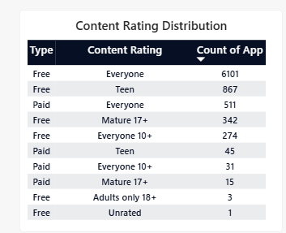

**Answer:** The screenshots show the free/paid split and review totals for individual popular apps, but not the average reviews grouped by app type. This comparison needs the mean of `Reviews` calculated separately for Free and Paid apps.

### 9. What is the average app size for each category?

**Answer:** The deep-dive screenshot reports average size by **genre**, not by **category**. It therefore does not answer the category-level question. Grouping app size by `Category` and calculating the mean is needed for a valid comparison.

### 10. How many apps were last updated in 2018?

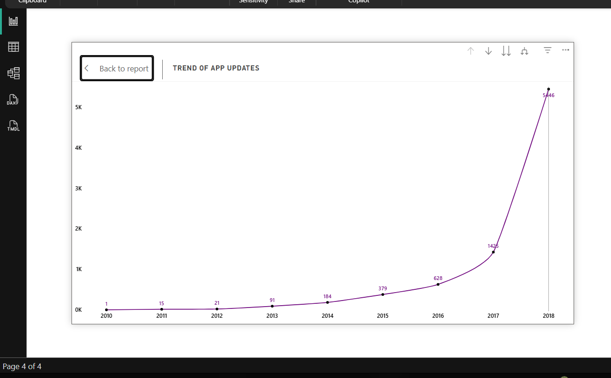

**Answer:** The update trend labels **5,440 apps** for 2018. This is the number of dataset records whose displayed `Last Updated` year is 2018, not the number of update events made during that year.

## Medium-level questions

### 1. What is the correlation between installs and app rating?

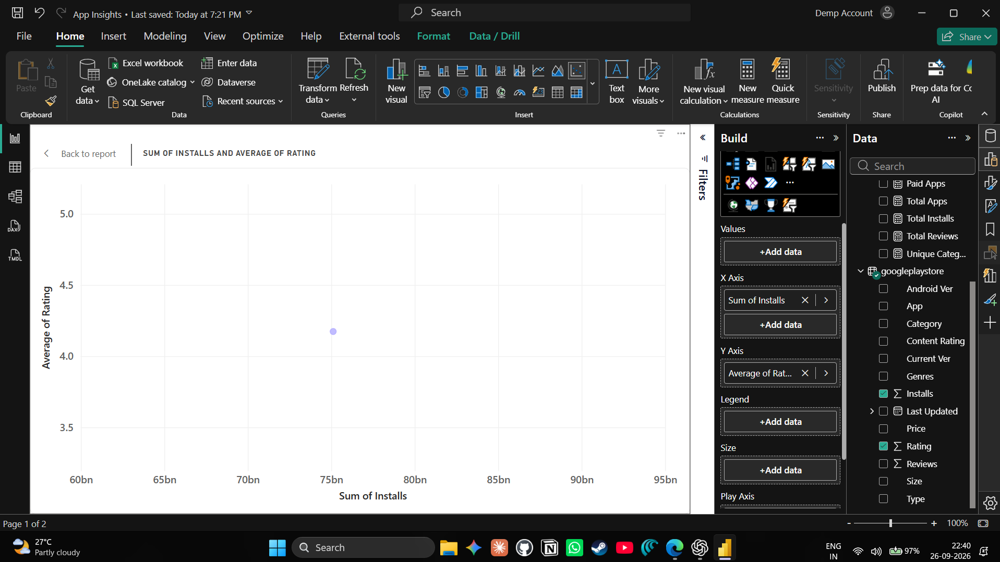

**Answer:** The screenshot shows one aggregate point for total installs and average rating. A single aggregated point cannot establish a correlation between app-level installs and ratings. The app-level records and an appropriate correlation analysis are not shown.

### 2. Which app categories have the highest average rating?

**Answer:** **Events** has the highest displayed category average at **4.44**, followed by Art & Design (**4.38**), Education (**4.36**), Books & Reference (**4.34**), and Personalization (**4.33**). Category averages can be affected by the number of apps and ratings in each group, which is not shown alongside this ranking.

### 3. How does the price of an app affect its average rating?

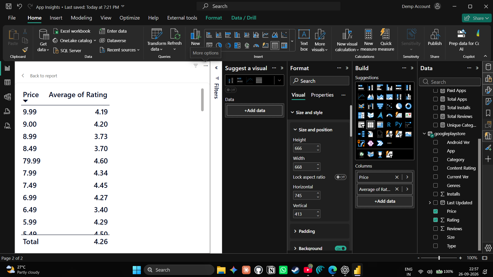

**Answer:** The table shows ratings at individual price points and a displayed overall average of **4.26**. The examples are not a consistent upward or downward sequence: for instance, the listed $9.99 price has an average of 4.19, while $79.99 has 4.60 and some lower prices have averages in the 3s. These rows do not prove that price causes a rating change. A paid-app-only analysis with app counts per price or sensible price bands would be needed.

### 4. What is the distribution of app ratings across different content ratings?

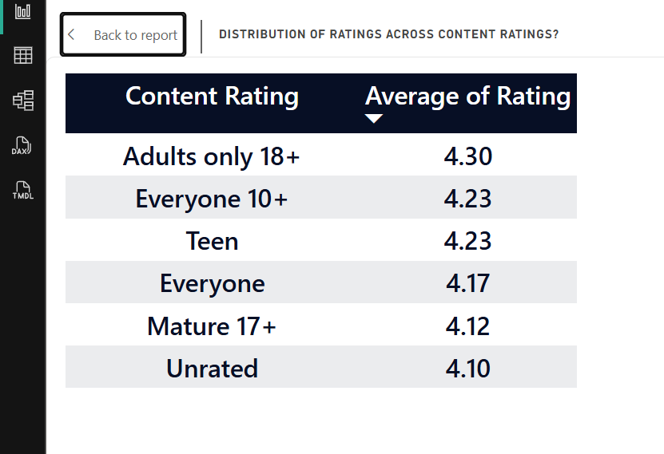

**Answer:** The displayed averages are Adults only 18+ (**4.30**), Everyone 10+ (**4.23**), Teen (**4.23**), Everyone (**4.17**), Mature 17+ (**4.12**), and Unrated (**4.10**). This visual compares average ratings by content rating; it is not a full rating-frequency distribution. The Adults-only and Unrated groups have very few records in the count screenshot, so their averages are especially sensitive to individual apps.

### 5. Which genres have the most apps with over 1 million installs?

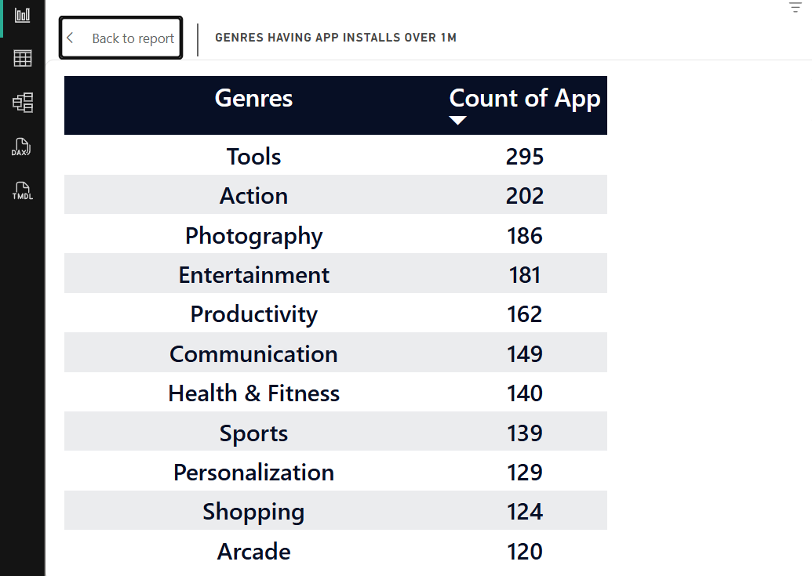

**Answer:** Tools leads with **295 apps**, followed by Action (**202**), Photography (**186**), Entertainment (**181**), and Productivity (**162**). Communication has 149, Health & Fitness 140, Sports 139, Personalization 129, and Shopping 124. These are app counts for the filtered view, not total installs by genre.

### 6. How frequently do apps get updated? What is the average time between updates?

**Answer:** The chart shows the number of apps by their recorded last-update year: 1 (2010), 15 (2011), 21 (2012), 91 (2013), 184 (2014), 379 (2015), 628 (2016), 1,425 (2017), and 5,440 (2018). This indicates many records have recent dates in the dataset, but it does **not** provide the average time between updates. With only one `Last Updated` date per app, consecutive update intervals cannot be calculated.

### 7. What is the impact of app size on the number of installs?

**Answer:** The supplied size plot shows counts across app-size values, not installs per app or total installs by size. It cannot establish whether larger apps receive more or fewer installs. An app-level analysis comparing `SizeMB` with `Installs` is needed before drawing that conclusion.

### 8. Which apps have the highest number of reviews, and what are their ratings?

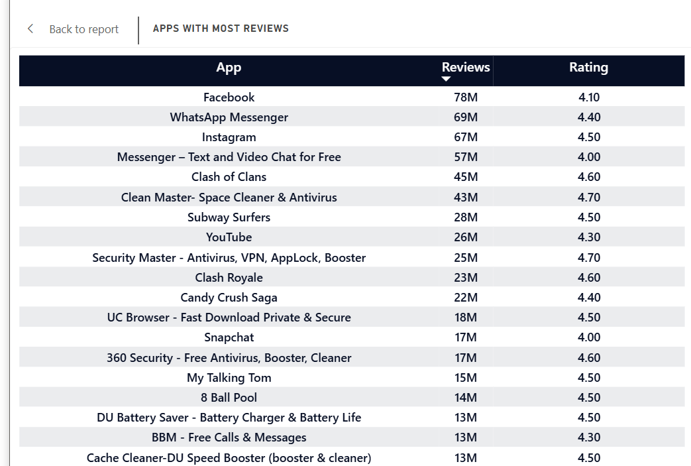

**Answer:** Facebook leads with **78M reviews** and a **4.10** rating. Next are WhatsApp Messenger (**69M, 4.40**), Instagram (**67M, 4.50**), Messenger – Text and Video Chat for Free (**57M, 4.00**), and Clash of Clans (**45M, 4.60**). High review volume signals substantial engagement, but does not necessarily mean the app has the highest rating.

### 9. How does the content-rating distribution differ between free and paid apps?

**Answer:** The screenshot shows the following counts:

| Content rating | Free apps | Paid apps |
| --- | ---: | ---: |
| Everyone | 6,101 | 511 |
| Teen | 867 | 45 |
| Mature 17+ | 342 | 15 |
| Everyone 10+ | 274 | 31 |
| Adults only 18+ | 3 | 0 |
| Unrated | 1 | 0 |

Everyone is the largest content-rating group for both free and paid apps. The paid-app counts are smaller in every displayed group. These table counts sum to 8,190, which differs from the 8,174 app KPI on the overview.

### 10. What are the top 5 categories with the most installs?

**Answer:** Game leads with approximately **14 billion installs**, followed by Communication (**11 billion**), Tools (**8 billion**), Productivity (**6 billion**), and Social (**5 billion**). These are rounded chart labels.

## Advanced-level questions

### 1. What are the top 10 highest-rated apps, and how do their reviews and installs compare?

**Answer:** The supplied screenshots do not show a reliable top-10 list sorted by app rating, so the specific top 10 cannot be identified here. The reviews table demonstrates that highly reviewed apps have ratings ranging from 4.0 to 4.7, but it is ranked by reviews, not by rating. A rating-ranked view should include review and install counts and ideally a minimum-review threshold; otherwise apps with only a handful of ratings can appear at the top.

### 2. What update patterns or seasonal trends appear over time?

**Answer:** The yearly counts climb from **1 app in 2010** to **5,440 in 2018**, with a pronounced increase in 2017 (**1,425**) and 2018. This shows a strong year-over-year concentration in the available data, but the chart is annual rather than monthly or seasonal. It cannot establish seasonal update patterns, and the available date range ends in 2018.

### 3. How does average rating change with the number of installs? (Binned analysis)

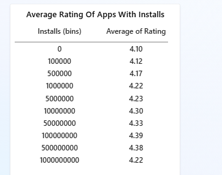

**Answer:** The displayed averages generally rise from **4.10** in the zero-install bin to a peak of **4.39** at 100 million installs. Other values are 4.12 (100K), 4.17 (500K), 4.22 (1M), 4.23 (5M), 4.30 (10M), 4.33 (50M), 4.38 (500M), and 4.22 (1B). The relationship is not strictly increasing, and the screenshot does not show how many apps are in each bin.

### 4. What themes do high- and low-rated app reviews contain?

**Answer:** Sentiment analysis cannot be performed from the supplied material. The dataset fields described in the brief include a review **count**, but not the review text itself. Text feedback would need to be obtained separately and analyzed with appropriate privacy and data-handling practices.

### 5. Which genres are consistently rated higher or lower?

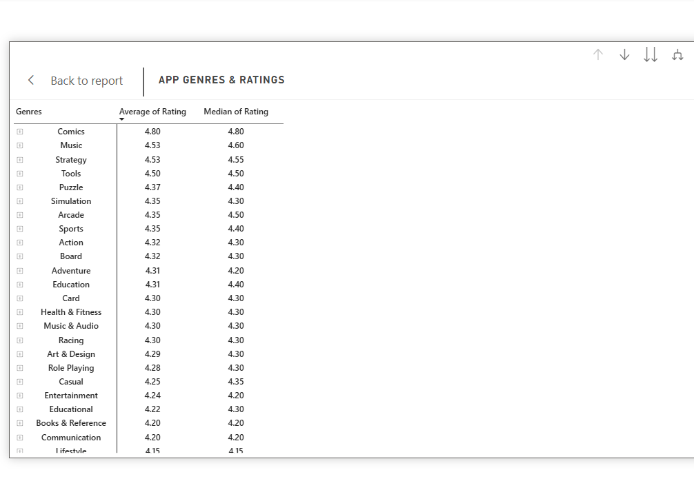

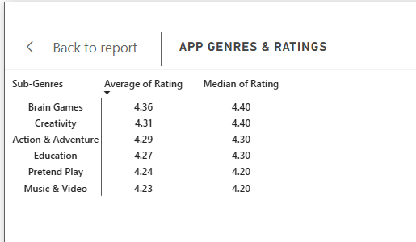

**Answer:** In the displayed genre table, Comics has the highest average (**4.80**, median **4.80**). Music and Strategy average **4.53**; their medians are **4.60** and **4.55** respectively. Tools averages **4.50** with a **4.50** median. In the subgenre table, Brain Games averages **4.36** (median **4.40**), Creativity **4.31** (median **4.40**), and Action & Adventure **4.29** (median **4.30**). These are descriptive comparisons; they do not establish that every app in a genre performs similarly.

## Recommendations and limitations

- Use the dashboard's high-install categories and genres as starting points for market research, not as proof that entering those markets will guarantee downloads.
- Evaluate rating together with review volume and installs. Small groups and apps with very few reviews can produce misleadingly high averages.
- Before making price or size decisions, compare apps at the app level and control for category, installs, and review counts.
- Reconcile the **8,174** overview app total with the **8,190** content-rating/type table total before publishing final counts.
- The supplied dashboard does not answer every question in the case-study brief. Missing counts, category-level size averages, update intervals, text sentiment, and app-level install/rating relationships should be computed from the source data before being presented as findings.

## Additional screenshots

The following screenshots document data exploration and transformation steps. Filter menus show available values, not additional analysis results.

| Step | Screenshot |
| --- | --- |
| Checking repeated app names in Power Query | [View](screenshots/power-query-duplicate-check.png) |
| Inspecting review values | [View](screenshots/review-filter-values.png) |
| Inspecting genre values | [View](screenshots/genre-filter-values.png) |
| Inspecting content-rating values | [View](screenshots/content-rating-filter-values.png) |
| Inspecting install values | [View](screenshots/install-filter-values.png) |
| Filtering app-size units | [View](screenshots/size-unit-filter.png) |
| Converting kilobytes to megabytes | [View](screenshots/size-kilobyte-conversion.png) |
| Configuring size bins | [View](screenshots/size-bin-configuration.png) |
| Detailed popular-app review table | [View](screenshots/top-reviews-table-detail.png) |

## Repository contents

- [`docs/App Insights (PowerBI).pdf`](docs/App%20Insights%20(PowerBI).pdf) — supplied case-study brief and question set
- `screenshots/` — dashboard and Power Query screenshots used in this solution guide
- `README.md` — project overview, all 25 question responses, evidence, and limitations

## Tools and data

- Power BI Desktop for measures, modeling, and report visuals
- Power Query for data inspection and transformation
- [Google Play Store Apps dataset](https://www.kaggle.com/datasets/lava18/google-play-store-apps) as referenced by the case-study brief

The screenshots and PDF are supporting material; the Power BI project file and source dataset were not included in the supplied attachments.
